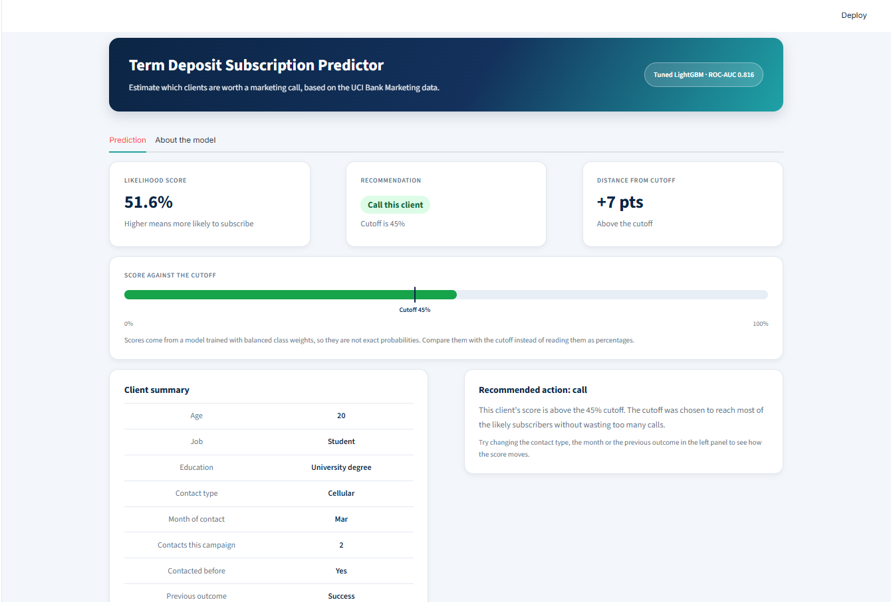
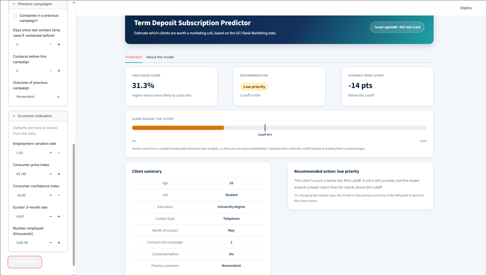
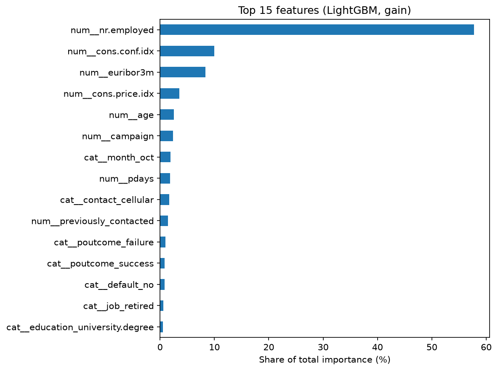

# Bank Term Deposit Subscription Predictor

A machine learning project that predicts which bank clients are likely to subscribe to a term deposit after a marketing phone call, so a call team can focus on the clients most worth contacting.

**Live demo:** https://bank-term-deposit-prediction-41k.streamlit.app/ (if the app has been idle, it may take a moment to wake up)

## Summary

- **Data:** UCI Bank Marketing (41,188 phone calls from a Portuguese bank, about 11% subscribed).
- **Task:** binary classification with heavy class imbalance.
- **Best model:** tuned LightGBM, test ROC-AUC **0.816**.
- **Decision cutoff:** 0.45, which finds 68% of subscribers with 36% of calls succeeding (11% when calling at random).
- **App:** a Streamlit dashboard where you enter a client's details and get a score and a call / low-priority recommendation.

## App preview

**A client above the cutoff (worth calling):**



**A client below the cutoff (low priority):**



## What I did

1. **Data cleaning and EDA.** Checked hidden "unknown" values, the class balance, and subscription rates by group, always checking group sizes before trusting a rate.
2. **Avoided data leakage.** Dropped `duration` (call length), which is only known after the call. Fixed `pdays` (999 means "never contacted") by adding a `previously_contacted` flag.
3. **Leak-free pipeline.** Scaling and one-hot encoding live inside a scikit-learn `Pipeline`, fit on training data only.
4. **Model comparison.** Compared linear, distance-based, tree, bagging and boosting models on the same split.
5. **Tuning.** `GridSearchCV` with stratified 5-fold cross-validation on ROC-AUC (Random Forest CV 0.796, LightGBM CV 0.798).
6. **Threshold tuning.** Chose the cutoff from cross-validated predictions on the training set, so the test set stayed untouched.
7. **Interpretation.** Feature importance and a feature-removal experiment.
8. **Deployment.** Saved the pipeline with joblib and built a Streamlit dashboard, deployed on Streamlit Community Cloud.

## Results

Test set (8,238 clients), default 0.5 cutoff:

| Model | ROC-AUC | Recall (yes) | Precision (yes) | F1 (yes) |
|---|---|---|---|---|
| LightGBM (tuned) | **0.816** | 0.659 | 0.394 | 0.493 |
| LightGBM | 0.815 | 0.652 | 0.402 | 0.497 |
| Random Forest | 0.814 | 0.638 | 0.414 | 0.502 |
| Random Forest (tuned) | 0.813 | 0.641 | 0.405 | 0.496 |
| Logistic Regression (balanced) | 0.801 | 0.645 | 0.368 | 0.469 |
| Logistic Regression | 0.801 | 0.219 | 0.688 | 0.332 |
| AdaBoost | 0.800 | 0.205 | 0.714 | 0.318 |
| Decision Tree | 0.792 | 0.614 | 0.414 | 0.495 |
| SVM | 0.783 | 0.633 | 0.413 | 0.500 |
| Naive Bayes | 0.776 | 0.597 | 0.337 | 0.431 |
| KNN | 0.745 | 0.306 | 0.592 | 0.403 |

*SVM was evaluated in an earlier run and is not part of `model_comparison.csv`.*

ROC-AUC is the main comparison metric because it does not depend on the cutoff. Accuracy is misleading here: always predicting "no" is already about 89% accurate. SVM took about 159 seconds to train with no gain, so it was dropped from tuning.

### Choosing the cutoff

Lowering the cutoff trades precision for recall. On the training set, F1 is highest around 0.65 to 0.70, but if one subscription is worth about 10 calls (an **assumption**, not real bank data), profit is highest near 0.45. At 0.45 on the test set:

- 634 of 928 subscribers found (recall 0.68), 294 missed
- 1,786 calls made, 35.5% of them successful (11.3% when calling at random)
- Under the 10-to-1 assumption, about 4.4 times the profit of calling everyone

## Key findings

- Only 11.3% of clients subscribe, so the data is heavily imbalanced.
- Cellular contact (14.7%) beats telephone (5.2%).
- Clients with a successful previous campaign subscribed 65.1% of the time (1,373 clients).
- Students and retirees subscribe most. Some months show very high rates but with few clients, so they are treated with caution.
- Economic indicators carry about 80% of the model's importance (`nr.employed` alone about 58%).
- Removing the economic columns lowered test ROC-AUC from 0.816 to 0.783, and removing only `emp.var.rate` and `euribor3m` lowered it to 0.808, so all features were kept.



## Limitations

- The economic indicators describe the campaign period (2008 to 2010), so the model may not hold in a different economic climate.
- The model uses balanced class weights, so scores are not exact probabilities. Compare them with the cutoff instead of reading them as percentages.
- The 10-to-1 call-to-sale value is an assumption used to pick the cutoff.
- Feature importance shows what the model uses, not what causes a subscription.

## Run it locally

Python 3.11 or newer is recommended.

```bash
pip install -r requirements.txt
streamlit run app.py
```

Open the notebook `bank_term_deposite_prediction.ipynb` to see the full analysis.

## Project structure

```
app.py                                  Streamlit dashboard
bank_term_deposite_prediction.ipynb     Full analysis
final_model.joblib                      Saved pipeline (preprocessing + tuned LightGBM)
model_info.joblib                       Cutoff and column list
bank-additional-full.csv                Dataset (UCI Bank Marketing)
model_comparison.csv                    Model comparison table
feature_importance.png                  Feature importance chart
app_yes.png, app_no.png                 App screenshots
requirements.txt                        Library versions
.streamlit/config.toml                  Light theme for the app
```

## Tech stack

Python, pandas, NumPy, scikit-learn, LightGBM, Streamlit.

## Data source

Moro, Cortez and Rita (2014), UCI Machine Learning Repository, Bank Marketing dataset (CC BY 4.0).
